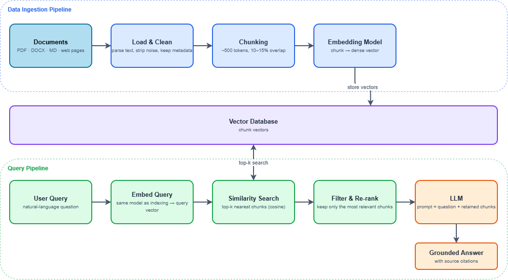

  # Using Retrieval Augmented Generation to Help Kenyans Verify Online Information

  - In this project Natalie, Benir and Tabitha utilize a Naive RAG framework as a mechanism to add context to existing Large Language Models
  
  

> **Status:** Academic Project, 4 November 2026

## Table of Contents
---

- [Motivation](#motivation)
- [Key Features](#key-features)
- [Retrieval Corpus](#retrieval-corpus)
- [Limitations](#limitations)
- [Ethics and Data Use](#ethics-and-data-use)
- [Authors](#author)

---

## Motivation

Misinformation spreads quickly on Kenyan social media, especially around elections and national events such as the 2022 General Election and the 2024 Finance Bill protests. This tool is designed to help kenyans get information from verified sources.

## Key Features

- **Evidence retrieval** from fact-check articles and trusted Kenyan news, returned with source links
- **Reproducible notebooks** documenting the full path from raw data to the modelling dataset

## Retrieval Corpus

| Dataset | Purpose |
|---|---|
| Kenyan Constitution |  Loading, Chunking and Embedding |
| UDA Political Party Manifesto 2022 | Loading, Chunking and Embedding  |
| Azimio La Umoja Political Party Manifesto 2022 | Loading, Chunking and Embedding  |
| IEBC Electoral Regulations | Loading, Chunking and Embedding  |

## Limitations

- Labelled Kenyan misinformation data is small and mostly social-media text, so results may not transfer to long-form news articles.
- Labelling is partly subjective, and political content is sensitive to annotation choices.
- Code-switched Swahili-English text is under-resourced in pretrained models.
- Models can drift as topics and events change; a fixed training set ages quickly.
- English benchmarks such as ISOT can yield near-perfect scores through source artefacts, so they are not treated as evidence of real-world performance.

## Ethics and Data Use

- The tool provides decision support, not a final judgement of truth. Verdicts should always be read alongside the retrieved sources.

## Authors

**Benir Omenda**,**Natalie Abwoga**,**Tabitha Mukina**
Computer Science, Strathmore University, Nairobi, Kenya

## License

Code is released under the MIT License (add a `LICENSE` file). Datasets remain under their original licences.